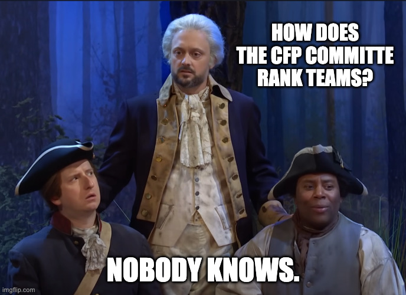
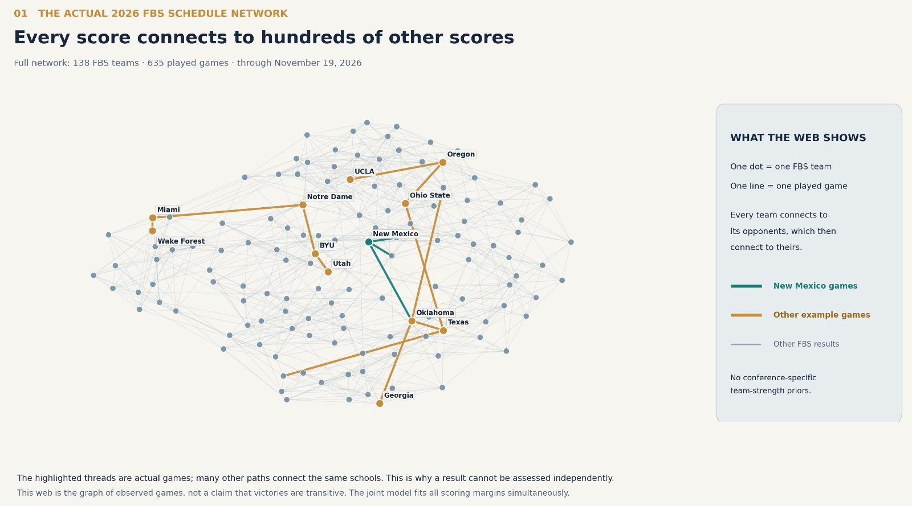
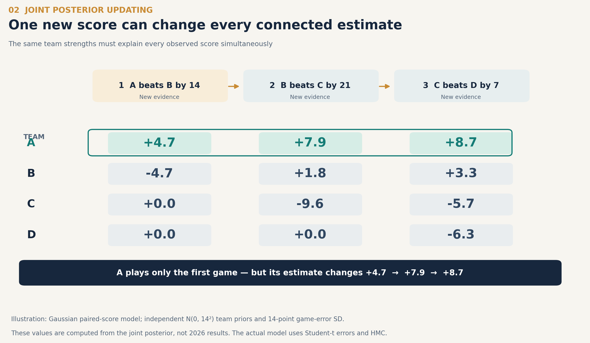
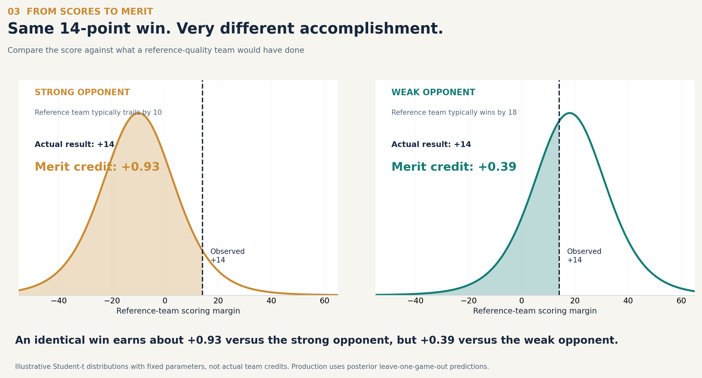
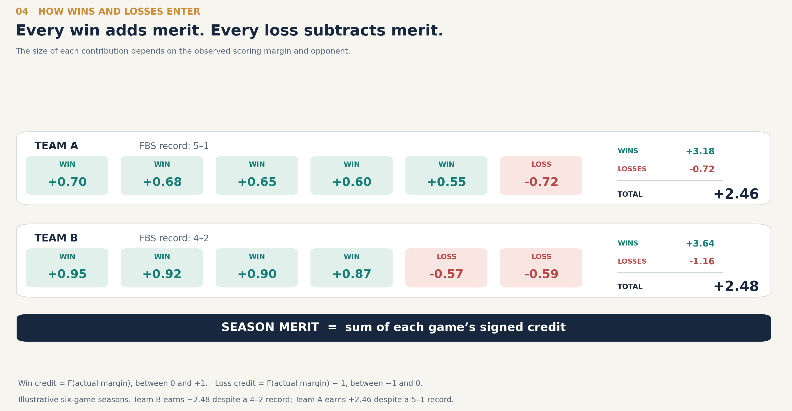
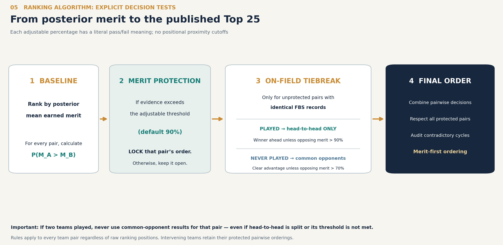
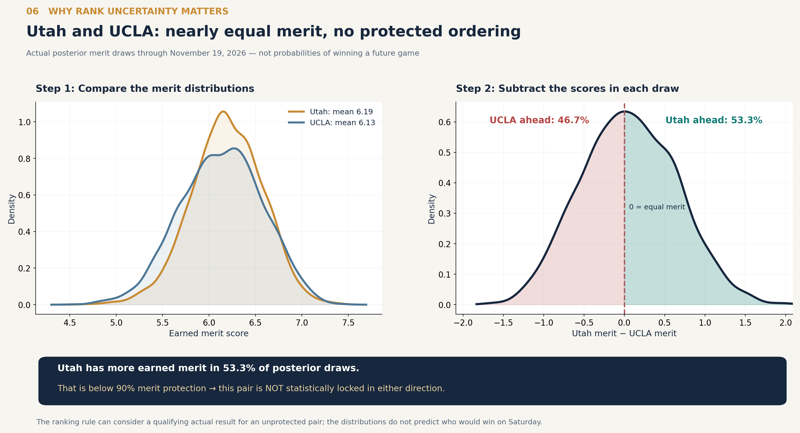
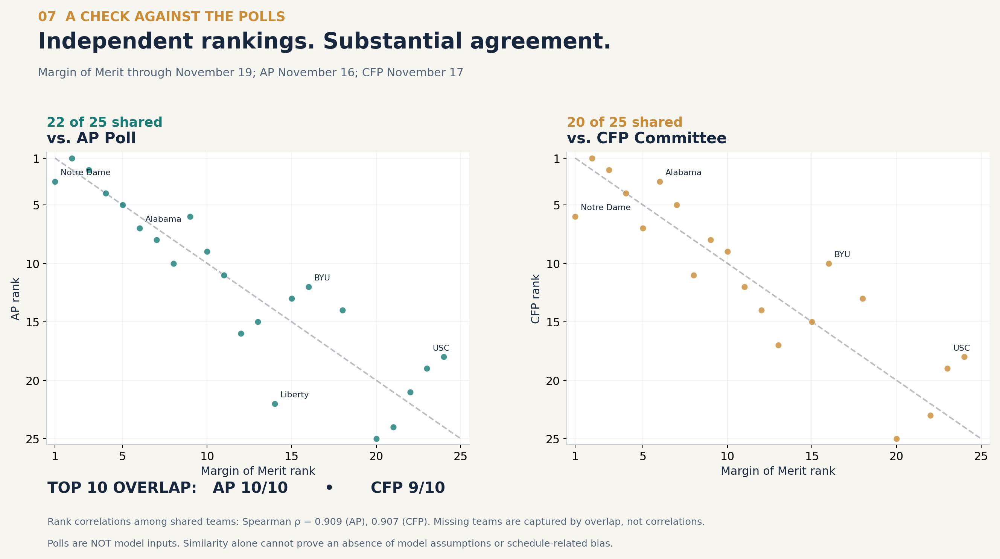

*Introducing the CFB Margin of Merit Rankings: a transparent, Bayesian approach to evaluating what teams have actually earned on the field.*

I'm a big sports fan, and one of my favorite sports is College Football. Not football in general, but specifically College Football. The tradition, the pageantry, the unpredictability, the chaos. Every fall, college football fans end up in the same argument. Which teams deserve to be ranked the highest at the end of the season? This argument has evolved over the years. Before the BCS it was simply who deserved to be crowned the national champion. Then it was who deserves to play in the National Championship. Then it became who deserves to play in the 4-team College Football Playoff. Now it's the 12-team playoff, and there is already discussion of expanding it further. And there's been plenty of controversy over the years -- 2023 FSU, 2004 Auburn, 2003 USC, 2011 Oklahoma State -- just to name a few. Just last year we had 10–2 Notre Dame left out of the 12-team CFP. And I don't see this going away; the controversy just shifts. If the playoff eventually expands to 24 teams, the debate becomes who gets that 24th spot, while the arguments at the top turn to first-round byes and home-field advantage. 

We debate which conference is stronger, how much a loss should matter, and whether an undefeated team with a weak schedule is more deserving than a two-loss team that played several of the best teams in the country.

And since 2014, every November, the College Football Playoff selection committee emerges from its deliberations, releases its rankings, and attempts to explain its decisions. How?

This entire process is ridiculous. [Mike Leach (RIP)](https://www.youtube.com/watch?v=y_nuMEtwUW4) nailed the absurdity nearly a decade ago, and it's only gotten worse. [Josh Pate's](https://www.youtube.com/watch?v=EY24JN-3FWU) rant just yesterday (at the time of this posting, November 20, 2026) captures my frustration with the committee and its approach to rankings. The problem isn't necessarily that the committee selects the wrong teams. It's that **there is no consistent, reproducible way to determine how it arrives at its decisions.**

One week, strength of schedule is emphasized. Another week, head-to-head results are decisive. Then perhaps a team's quality wins become the determining factor. Margin of victory matters when it's convenient. And sometimes a team is apparently just *better*, regardless of what it has actually accomplished. The committee has "published" selection criteria. It considers strength of schedule, head-to-head results, common opponents, and other measures of performance. But there is no transparent rule describing how those considerations are combined. And they apply them wildly inconsistently. 

Instead, thirteen people deliberate, compare teams, and ultimately vote. I don't care how much "reasoning" they give, what statistics they use -- they're effectively picking playoff teams and seeds based off vibes, and then post-hoc cherry picking the stats that fit the narrative they want. 

And they're picking teams based on what they **think** will happen, not based on resume, which I find to be the antithesis of competition. Results matter. I don't care what you **think** will happen. I don't care who you'd bet on. I don't care that in a theoretical world, that you think Team A will beat Team B 90% of the time. If Team A has the same record as Team B, and Team B won their head-to-head matchup, that result needs to matter. You can't just dismiss it because a power rating favors Team A. I don't care if a player got injured and that changes your perspective on how you **think** the team will perform going forward. This is a team based sport. Results matter. 

Cue [Josh Pate again](https://www.youtube.com/watch?v=VbO-Ma6tMb), in reference to the possibility of FSU getting left out of the 2023 CFP because their QB Jordan Travis got injured: "I detest the concept of a committee of people gathering together and deciding they know for sure the value of a football player. And how he benefits your team and without him what your team is. I cant stand that. I really think its time to emphasize ahead of time... is the difference better Vegas and merit. Power ratings and merit... It doesn't matter what you think you know. It matters what's been earned on the field by a football team. You can sit there and tell me that injuries are a part of football (which is accurate)... one player goes down... I got 21 others starting any given Saturday. It's a team game. Don't tell me injury is part of the game and then completely change the way you define merit and the way you select your teams from your committee because 'football happened.'"

"Games are played on the field, not paper"

Then the committee did it anyway.  After then leaving out undefeated FSU from the CFP, Bill Hancock (executive director of the CFP at the time) said, "Most deserving is not anything in the committee's lexicon. They are to rank the best teams in order, and that's what they do. Just keep that word in mind, best teams."

They changed their criteria. Again. And for the first time in the decade of the CFP choosing teams, they now say its based on their perception of "best" and not most deserving. [Josh Pate](https://www.youtube.com/watch?v=pfacP3nxqVc) again, called them out on this inconsistency. Even [Pate] agreeing that if "best" is the criteria, then Alabama deserved in over FSU, he says directly, "The Florida State folks are mad because they changed the rules in the middle of the game. And I cannot disagree with them. I think that's exactly what happened... I think the committee was baking expectations into the rankings. They expected you to lose... And then a source from the playoff committee... 'It was gut wrenching... for me individually, I evaluated whether FSU could make it through and win a national championship with the team they had.'... Now I'm telling you... it's complete garbage. If that's the methodology that anyone, much less an entire committee, used to keep Florida State out is garbage." 

You know what. I think I'm pretty strongly in-line with Josh Pate here. He has my vote for CFB commissioner. 

Imagine if the NFL decided its playoff seeding this way. A team finishes 12–5, another finishes 11–6, and a committee decides that the second team simply looks better. Maybe it had a harder schedule. Maybe it won more convincingly. Maybe its quarterback got injured, but the committee thinks it would have won with him healthy. Maybe a loss in October counts less than one in December.

That is not how sports are supposed to work. Results matter. No other professional sport on earth selects and seeds teams for a playoff based on *what they think would happen*. They select them off merit, off results of the season. And right now, as I write this, we're having the same debates about the current season. **This is an unacceptable way to evaluate what teams have earned.**

## The problem is harder than it looks

Now, there's an obvious objection to everything I just said: college football isn't the NFL. The Football Bowl Subdivision (FBS) has more than 130 teams, and each team plays only about 12 regular-season games. Most of those games occur within conferences, leaving relatively few opportunities to compare teams across the country.

Think about what that means. An SEC team might play eight conference games and several non-conference opponents. A Big Ten team faces an almost entirely different set of opponents. A Group of Five team may go undefeated without ever playing either of them.

How do we determine whether one team's 11–1 record is better than another team's 10–2 record? We can't simply compare wins. A win over Georgia tells us something very different from a win over Kent State (sorry Kent State, I don't mean any offense). But we also can't simply compare strength of schedule. Losing to excellent teams doesn't necessarily mean you've accomplished more than someone who actually beat the opponents in front of them. And we can't resolve everything using head-to-head results, because most teams never play each other.

In a 138-team FBS, there are

$$
\binom{138}{2}=9{,}453
$$

possible pairwise matchups.

A typical regular season contains only a fraction of those games, and the schedule isn't remotely balanced. **There is no way to construct a perfectly objective ranking from such incomplete information.** Some inference is unavoidable. But here's my argument: **the necessity of inference doesn't justify abandoning consistency or transparency.**

We can use mathematics to evaluate the information that actually exists, quantify what we don't know, and establish clear rules for how that evidence determines a ranking. We don't need thirteen people in a room deciding which statistics matter this week.

## What are we actually trying to rank?

So before introducing the model, there's an important distinction: **the best team isn't necessarily the most deserving team.** See my above rant. Suppose Team A is exceptionally talented, but loses three close games against excellent opponents. Team B goes undefeated against a more modest schedule.

If they played tomorrow on a neutral field, Team A might be favored. That's a predictive question: *Who is more likely to win?* This is what Vegas answers. This is what power ratings are. It's an interesting question in it's own right. But that's not the same as asking which team has earned the higher ranking through its actual results.

The second question is what interests me. It's kind of ironic that so much of my methodological research focuses on prediction and quantifying uncertainty prospectively, because here I care only about what's happened in the past. There are already plenty of predictive power ratings. They attempt to determine how teams would perform in hypothetical matchups, often using offensive efficiency, defensive efficiency, player quality, recruiting, and dozens of other variables.

Those models have their place. But I don't think we need to estimate every team's passing offense, run-blocking ability, defensive coverage, and quarterback talent to evaluate its résumé. At some point, we're trying to explain every component of football when the most relevant evidence is sitting directly in front of us. **Who did you play? Did you win? And by how much?** That's the information I want to use. 

Why? Because winning and scores, I would argue, are the ultimate manifestation of team quality in aggregate. I do not think that breaking down all of these individual level metrics and trying to model a teams "strength" based on 20 derived latent variables can be done with enough precision to honestly discriminate between teams of similar quality. What differentiates two teams with similar schedules shouldn't be these noisy constructs, but results that actually happened. 

And importantly, that's *all* I want to use. No recruiting rankings, preseason polls, historical reputation, or assumptions about how good a team ought to be. Every season starts fresh.

## Introducing Margin of Merit

I've been developing a ranking system I'm calling the **Margin of Merit Rankings**.

The name has two meanings. First, scoring margins matter: beating a strong opponent by 28 points is different from beating a weak opponent by 28. Second, the rankings themselves have margins. We shouldn't merely say Team A is sixth and Team B is seventh. We should quantify how much evidence separates them and how uncertain that ordering is. And we can. 

The entire system is based on five principles:

1. Actual wins and losses are the foundation of merit.
2. Opponent quality is learned from the entire network of FBS and FCS game results.
3. Scoring margins provide additional information, with bounded credit for increasingly large victories.
4. Head-to-head and common-opponent results determine qualifying comparisons through explicit posterior-probability thresholds or proximity in the rankings, with conflicts resolved by a consistent evidence hierarchy.
5. Rankings should communicate uncertainty rather than manufacture precision.

This is founded on fairness and transparency, and rankings are purely based on merit of what's happened on the field. The implementation uses a Bayesian model framework, but the underlying idea is fairly straightforward.

## Learning from the entire network of games

Imagine three teams: Team A beats Team B by 35 points. Team B loses its next four games by 25, 30, 28, and 35 points. That makes Team A's victory look considerably less impressive than it first appeared. Now imagine instead that Team B beats three strong opponents and narrowly loses to a fourth. Suddenly, Team A's 35-point victory looks extraordinary. The score against Team B hasn't changed. What changed is our understanding of how good Team B actually is. And that information doesn't stop at Team B's direct opponents. Their results against other teams also contribute to our understanding. This conceptually expands across a network of all 138 FBS teams and the FCS opponents connected to them, in an interconnected web that no one could reasonably draw out.

**College football is a network of interconnected game outcomes.** The mathematical model needs to account for that network. I start with a scoring-margin version of a paired-comparison model, related in spirit to the Bradley–Terry framework. Rather than fitting only whether a team won or lost, I use the final scoring margin from completed FBS-versus-FBS, FBS-versus-FCS, and FCS-versus-FCS games. Why? Because a win by 3 is not the same as a win by 28.

Including FCS teams matters because an FBS win against an FCS opponent should not count for literally nothing. Tennessee, for example, beat Furman 56–9. Leaving that game out entirely meant Tennessee was effectively missing a win in its comparison with Alabama. I now estimate FCS opponents using the same scoring-margin model and count FBS teams’ results against them. The FCS teams help establish opponent quality; they are not candidates for the FBS rankings. FCS playoff games don't count; conference championship games, FBS or FCS, do. The 2026 fit through November 19 uses 1,350 games involving 138 FBS and 128 FCS teams.

*Figure 1. The FBS portion of the 2026 schedule network: 138 FBS teams connected by 635 FBS-versus-FBS games through November 19. Every dot represents an FBS team, and every line represents a completed game between FBS teams. Highlighted connections help trace multiple routes through New Mexico, Oklahoma, Texas, Georgia, Ohio State, Oregon, Utah, UCLA, Notre Dame, and Miami. The expanded statistical fit also includes FBS-versus-FCS and FCS-versus-FCS games, which are not drawn here. The network does **not** assume that wins are transitive.*

### The Bayesian model: likelihood, priors, and posterior

Let $$\theta_i$$ represent the underlying strength of team $$i$$, measured in points. For game $$g$$, let $$h(g)$$ and $$a(g)$$ denote the designated home and away teams, and define the observed scoring margin as

$$
Y_g=\text{Home points}_g-\text{Away points}_g.
$$

For neutral-site games, we don't award either team a home-field advantage. With $$z_g=1$$ for a true home game and $$z_g=0$$ for a neutral site, the likelihood is

$$
\boxed{
Y_g\mid\boldsymbol\theta,h,\sigma,\nu
\sim t_\nu\!\left(\theta_{h(g)}-\theta_{a(g)}+z_gh_{h(g)},\ \sigma\right).
}
$$

The expected scoring margin is the difference in the teams' strengths, adjusted for home field. The parameter $$h_{h(g)}$$ is the home-field advantage, in points, at the home team's stadium; $$\sigma$$ describes ordinary game-to-game variation; and $$\nu$$ controls the heaviness of the tails. I use a Student's *t* distribution because football scores are noisy and sometimes extreme. A few strange blowouts shouldn't completely dictate estimates of team strength, but I also don't want to throw away the information contained in actual scoring margins.

A Bayesian model also requires prior distributions. Here is the actual specification used in the 2026 implementation:

$$
\begin{aligned}
\theta_i &= \mu_{d(i)}+\gamma_{c(i)}+\tau_{d(i)}\,z_i,
&z_i &\overset{\mathrm{iid}}{\sim} N(0,1),\\
\gamma_c &= \tau_{\mathrm{conf}}\,w_c,
&w_c &\overset{\mathrm{iid}}{\sim} N(0,1),\\
\mu_{\mathrm{FBS}} &= 0,
&\mu_{\mathrm{FCS}},\ \tau_{\mathrm{FBS}},\ \tau_{\mathrm{FCS}},\ \tau_{\mathrm{conf}}&\ \text{flat},\\
h_k &= h_0+u_k,
&(h_0,u_1,\ldots,u_K) &\sim N\!\left(\widehat{\boldsymbol\mu}_{\mathrm{hist}},\ \widehat\Sigma_{\mathrm{hist}}+\Delta\right),\\
\eta_\sigma &\sim N(\log 6,0.75^2),
&\sigma &=8+e^{\eta_\sigma},\\
\eta_\nu &\sim N(\log 5,0.9^2),
&\nu &=2+e^{\eta_\nu}.
\end{aligned}
$$

Here $$d(i)$$ is team $$i$$'s division (FBS or FCS) and $$c(i)$$ is its conference. No teams get a higher prior because of recruiting, conference affiliation, history, or a preseason ranking. Every FBS team starts with **the same prior**, every FCS team starts with the same prior, and every conference gets the same prior. The FBS average is fixed at zero only to anchor the scale, since the likelihood only sees differences in strength. The FCS average, the spread of teams within each division, and the spread between conferences all have flat priors and are estimated from this season's games. Home-field advantage is the one place past seasons are used: a national home-field term plus a small adjustment for each FBS stadium ($$h_0$$ and $$u_k$$), learned from FBS-versus-FBS scores over the previous three seasons (2023–2025 for this year), with a little extra variance $$\Delta$$ to allow for year-to-year change. Past seasons never inform how good a team is. The eight-point lower bound is on the Student's *t* **scale**, not the standard deviation of team strength; it's a conservative regularization choice that prevents the model from estimating implausibly little game-to-game variation when only a handful of results exist early in the season. The same specification is used throughout the season.

With $$D=\{Y_1,\ldots,Y_G\}$$ denoting all included FBS and FCS game margins and $$\Theta=(\boldsymbol\theta,\boldsymbol\mu,\boldsymbol\gamma,\boldsymbol\tau,\mathbf h,\sigma,\nu)$$, Bayes' rule gives

$$
\boxed{
p(\Theta\mid D)
\propto
p(\Theta)\prod_{g=1}^{G}
t_\nu\!\left(Y_g\mid\theta_{h(g)}-\theta_{a(g)}+z_gh_{h(g)},\sigma\right).
}
$$

In plain English, the posterior combines the same starting assumptions for every team with the likelihood of all the scores we actually observed. I fit this joint posterior using Hamiltonian Monte Carlo, with four independent chains. Rather than getting a single strength number for Georgia or Texas, I get thousands of draws representing plausible combinations of **all** team strengths, home-field advantage, and game variability. As additional games are played, the posterior updates, and the network supplies more information about the relative quality of teams that may never face each other.

This is why strength of schedule emerges from the results rather than from arbitrary conference weights. Nothing in the prior says the SEC or Big Ten should be stronger than anyone else. If a conference consistently performs better against outside opponents, that evidence propagates through the network. And because the model is Bayesian, the uncertainty in comparisons between weakly connected teams remains visible.

### Why conferences show up in the prior

My first version gave every team, FBS and FCS, the exact same $$N(0,14^2)$$ prior. That sounds like the fairest possible choice. It isn't, and I only found that out by testing it.

Most games are played inside a conference. The only evidence about whether the Big Ten is better than the Mountain West comes from the relatively small number of non-conference games. If every team gets pulled toward one shared average, the gaps between conferences get squeezed. Teams in weaker conferences look a little better than they are, teams in stronger conferences look a little worse, and that feeds straight into how hard everyone's schedule looks. The same thing happens between FBS and FCS, which were never one population of teams to begin with.

To check, I simulated entire seasons on the real 2026 schedule from team strengths I chose, so I knew every team's true merit, and ran the full pipeline on each fake season. With the single shared prior, the 90% intervals contained the true merit only 42–73% of the time, depending on how the fake seasons were generated. And the misses weren't random. Merit was overstated for teams in the MAC (+0.77 on average), Conference USA (+0.70), and the Sun Belt (+0.68), and understated for SEC teams (−0.27). That's a conference bias, which is exactly what I'm trying to keep out.

So now FBS and FCS each get their own average, and conferences are treated as what they are: clusters of teams that mostly play each other. Every conference gets the same prior. The model estimates where each conference sits, and how far apart conferences are, from this season's results alone. If conferences didn't actually differ, that spread would go to zero and every team would be back to sharing one prior. In the same simulations, the 90% intervals now contain the true merit about 88–91% of the time, and the conference pattern mostly disappears. For 2026, the model puts the spread between conferences at about 11 points and the FCS average about 37 points below FBS.

### What it means for every team to be estimated simultaneously

I think the easiest way to understand the model is to stop imagining 138 separate team ratings and instead imagine one large system of equations that has to be consistent with all the scores. Let $$X$$ be a game-by-team matrix. Each row represents a game: it contains a $$+1$$ for the home team, a $$-1$$ for the away team, and zero for everyone else. With $$\boldsymbol\theta$$ collecting all team strengths, $$\mathbf z$$ indicating true home-field games, and $$\mathbf Y$$ collecting all scoring margins, we can write the entire season as

$$
\boxed{\mathbf Y=X\boldsymbol\theta+\mathbf z h+\boldsymbol\varepsilon,\qquad
\varepsilon_g\sim t_\nu(0,\sigma).}
$$

One row of $$X$$ describes the relationship between the two teams in one game. But the same team appears in many rows. To fit the score from A versus B, the model needs plausible strengths for both A and B. Those strengths must also fit B's games against C and D, which in turn depend on everyone *they* played. All the unknown team strengths are therefore being inferred together. The connection is mathematical, not merely an analogy. If $$r_g=Y_g-\mathbf x_g^\top\boldsymbol\theta-z_gh$$ is the unexplained margin in game $$g$$, then the way that game's likelihood pushes on team $$i$$'s strength is captured by

$$
\boxed{
\frac{\partial\log p(D\mid\Theta)}{\partial\theta_i}
=\sum_{g=1}^G x_{gi}\frac{(\nu+1)r_g}{\nu\sigma^2+r_g^2}.
}
$$

This is the score function, not a rule that directly assigns ranking points. The sign $$x_{gi}$$ makes a game push the two participating teams in opposite directions, while the residual $$r_g$$ captures whether the observed margin was larger or smaller than the model expected. The denominator reduces the influence of extreme residuals, one reason for using a Student's *t* model. When we update a team's strength, that changes how well we explain all of its other games, so the other teams' strengths adjust in response. HMC explores the joint posterior that balances these pressures across the entire schedule.

There is a particularly clean way to see the network structure in a simplified version of the model. If game errors were normal instead of Student's *t*, and we temporarily treated home-field advantage and residual variation as fixed, the posterior would also be normal. Writing $$\tau=14$$ for a single shared team-strength prior standard deviation, its posterior covariance matrix $$V$$ and posterior mean $$\widehat{\boldsymbol\theta}$$ would satisfy

$$
\boxed{
V^{-1}=\tau^{-2}I+\sigma^{-2}X^\top X,
\qquad
\widehat{\boldsymbol\theta}
=V\sigma^{-2}X^\top(\mathbf Y-\mathbf zh).
}
$$

The matrix $$X^\top X$$ is the graph Laplacian of the schedule network, counting games between teams and connecting opponents through its off-diagonal entries. Inverting the full matrix couples the posterior estimates across teams. **A score in a game involving B can change our estimate of A even when A has not played another game.** That closed-form calculation is for the simpler normal-error example; the actual published model uses the Student's *t* likelihood and the division and conference prior, and samples the joint posterior with HMC, rather than relying on this normal approximation.

For a small numerical illustration, suppose A beats B by 14 on a neutral field. Under the simplified normal-error model, A's posterior mean strength is about **+4.7 points**. Then B beats C by 21, and A's estimate rises to **+7.9**: beating B now means more because B has demonstrated its own quality. When C subsequently beats D by 7, A's estimate moves again, to **+8.7**. A hasn't played another game in either update. The new information has traveled through B and C. The full FBS–FCS network works on exactly that principle, with many more games and a more flexible likelihood.

*Figure 2. A worked illustration using a normal-error paired-score model with a single 14-point exchangeable prior standard deviation. The changes in A's posterior mean are mathematically calculated for this toy example, not estimated from 2026 teams. The production model uses the Student's t likelihood and the division and conference prior.*

This also explains a subtle feature of weekly rankings. A team can be idle for a week, and the model can still learn something new about its strength because its previous opponents played. That doesn't mean the idle team has suddenly *earned another win*. Its actual game results and win–loss record remain fixed. What changes is the context in which we evaluate those results—and, consequently, their estimated merit. The model distinguishes new evidence about an opponent from a new achievement by the team itself.

But there's another important distinction: **these underlying strength estimates are not the merit rankings.** They tell us how difficult a particular outcome was. To rank what teams have *earned*, I construct a separate measure from the games they actually played.

## How much is a particular victory worth?

Here's where the model gets interesting. Suppose Ohio State beats Alabama by 17 points. How impressive is that? One way to answer is to imagine a fixed reference-quality team—say, a team with approximately top-25 FBS strength—facing Alabama at the same venue. Based on the fitted model, what scoring margin would we expect that reference team to achieve? We can calculate an entire probability distribution of possible margins, then ask where Ohio State's actual 17-point victory falls within it.

The reference team isn't a particular school. In each posterior draw, I use the **25th-highest latent strength among FBS teams** as the benchmark. This means the reference itself is allowed to be uncertain, rather than pretending we know exactly how good the 25th-best team is. For a result by team $$i$$ against opponent $$j$$, let $$m_{ig}$$ be the actual margin from team $$i$$'s perspective, and let $$v_{ig}$$ be $$+1$$ at home, $$0$$ on a neutral field, and $$-1$$ away, with $$h_g$$ the home-field advantage at that game's stadium. The reference team's scoring-margin distribution has cumulative distribution function

$$
\boxed{
F_{ig}(m\mid\Theta)=
T_\nu\!\left(
\frac{m-(\theta_{\mathrm{ref}}-\theta_j+v_{ig}h_g)}{\sigma}
\right),
}
$$

where $$T_\nu$$ is the cumulative distribution function of the Student's *t* distribution and $$\theta_{\mathrm{ref}}$$ is the 25th-highest FBS $$\theta$$ in the particular posterior draw. In ordinary terms, $$F_{ig}(m)$$ tells us how often a top-25-caliber team would be expected to produce a margin **no greater than** $$m$$ against that specific opponent in that venue.

If very few plausible outcomes are as impressive as a 17-point victory, Ohio State has accomplished something substantial. If a typical top-25 team would be expected to beat that opponent by 25 points, the same 17-point win deserves less credit. We turn that comparison into a game-level measure of merit:

$$
\boxed{
c_{ig}=F_{ig}(m_{ig})-\mathbb{1}(m_{ig}<0).
}
$$

The indicator term equals 1 when the observed result is a loss and 0 otherwise. **Every win receives positive merit**, between 0 and 1, and **every loss receives negative merit**, between −1 and 0. A larger victory earns more credit than a smaller victory against the same opponent. Beating a strong opponent by 20 earns more than beating a weak opponent by 20; losing narrowly to an excellent opponent is penalized less than losing badly to a weak opponent. Because the scoring function is bounded, no team can accumulate unlimited merit by running up the score. A 40-point victory can earn more than a 22-point victory, without declaring the two results identical or creating arbitrary blowout categories.

*Figure 3. Two hypothetical games with the same 14-point win. Against the stronger opponent, a 14-point win exceeds about 93% of the reference team's predicted margins, earning +0.93 merit. Against the weaker opponent, it exceeds only about 39%, earning +0.39. The shaded areas represent those probabilities. The parameters are illustrative; the real calculation uses each game's own leave-one-out posterior.*

For each posterior draw $$s$$, I compute each game's credit using its corresponding posterior opponent and reference strengths, and sum the credits over the actual FBS team’s games, including FCS opponents, $$G_i$$:

$$
\boxed{
\mathcal M_i^{(s)}=\sum_{g\in G_i}c_{ig}^{(s)}.
}
$$

This gives every FBS team a **posterior distribution of earned merit**, not merely a point estimate. Its posterior mean is the foundation of the ranking, and its distribution lets me compare teams probabilistically. One important qualification: bounded credit doesn't eliminate every incentive to run up a score. It does ensure that credit has an upper limit and that extremely large margins eventually add very little.

There is another useful way to write that same season total. Let $$L_i$$ be the number of losses to FBS or FCS opponents on team $$i$$'s record. Because the negative indicator subtracts one for *every loss*, the full expression becomes

$$
\boxed{
\mathcal M_i^{(s)}
=\sum_{g\in G_i}F_{ig}^{(s,-g)}(m_{ig})-L_i,
\qquad
L_i=\sum_{g\in G_i}\mathbf1(m_{ig}<0).
}
$$

**That's exactly where record enters.** It isn't a separately chosen weight in an objective function. A loss subtracts one from the collection of benchmark CDF values; a win does not. The CDF terms capture *how well* the team performed against its actual opponents, with the home or away venue accounted for. So a record matters directly, but two teams with the same record can still accumulate very different amounts of merit. And the schedule affects those CDF values through opponents' jointly inferred strengths. Scores, records, and schedule quality aren't three disconnected criteria that a committee gets to balance differently each week: they are parts of the same defined calculation.

*Figure 4. Constructed six-game examples showing **net merit credit for each individual game**, not raw CDF values. A win contributes its positive reference percentile; a loss contributes its reference percentile minus one, producing a negative credit. Team A: five win credits totaling +3.18 and one loss at −0.72 give +2.46. Team B: four win credits totaling +3.64 and two losses totaling −1.16 give +2.48. Both records and opponent-adjusted margins enter explicitly.*

## An important statistical safeguard: Leave the game out

There's a subtle problem in evaluating an opponent's strength using the same game we're trying to score. Suppose Team A beats Team B by 40 points. That blowout is evidence that Team A is strong, but also evidence that Team B is weak. If we use that same game to make Team B look weaker and then evaluate how impressive Team A's victory was against the newly weakened opponent, we've created a feedback problem: the victory can discount itself.

Instead, I use **leave-one-game-out inference**. When evaluating a particular game, the opponent-quality comparison is based on the rest of the season's results, with that game omitted. If $$D_{-g}$$ denotes all the observed margins except game $$g$$, the relevant posterior is

$$
\boxed{
p(\Theta\mid D_{-g})
\propto\frac{p(\Theta\mid D)}{p(Y_g\mid\Theta)}.
}
$$

This relationship also gives a computational shortcut. Rather than refitting the entire Bayesian model hundreds of times, I use Pareto-smoothed importance sampling to approximate each game's leave-one-out posterior, with weights proportional to the **inverse** probability density of that game's observed score. I monitor the Pareto diagnostics and can refit individual games when the approximation becomes unreliable.

The raw importance weights for posterior draw $$s$$ are $$w_g^{(s)}=1/p(Y_g\mid\Theta^{(s)})$$. After normalizing, the leave-one-game-out expectation of any quantity $$u(\Theta)$$ can be approximated by

$$
\widetilde w_g^{(s)}
=\frac{w_g^{(s)}}{\sum_{r=1}^{S} w_g^{(r)}},
\qquad
\mathbb E[u(\Theta)\mid D_{-g}]
\approx\sum_{s=1}^{S}\widetilde w_g^{(s)}u(\Theta^{(s)}).
$$

These are the unsmoothed weights that motivate the calculation. In practice, Pareto smoothing stabilizes the largest importance weights before the leave-one-out quantities are evaluated. The main point is that the likelihood of the game we are evaluating is removed mathematically, rather than merely being ignored in a verbal description of schedule strength.

The per-game merit credit is therefore actually

$$
\boxed{
c_{ig}^{(s,-g)}
=F_{ig}^{(s,-g)}(m_{ig})-\mathbb{1}(m_{ig}<0),
\qquad
\mathcal M_i^{(s)}=\sum_{g\in G_i}c_{ig}^{(s,-g)}.
}
$$

This allows the opponent's other results—and the interconnected schedule network—to determine the value of the result without letting that same result directly discount itself. To combine game-specific leave-one-out calculations into season-level merit distributions, the current implementation uses an approximation to their joint dependence. The uncertainty I report is therefore estimated, not an exact probability law for every imaginable ranking.

## Strength of schedule, without conference reputation

The model also gives us a natural strength-of-schedule measure. For every opponent on a team's schedule, we estimate the probability that our reference-quality team would lose that matchup, accounting for venue. We then average those probabilities across the schedule:

$$
\boxed{
\operatorname{SOS}_i
=
\frac{1}{n_i}
\sum_{g\in G_i}
P(\text{reference loses game }g\mid D_{-g}).
}
$$

This produces a strength-of-schedule measure between 0 and 1. An SOS of 0.45 means our reference team would be expected to lose approximately 45% of those games. That's considerably more interpretable than saying someone has the 37th-hardest schedule according to a formula nobody can inspect. 

And we can quantify the uncertainty. For example, we can estimate the probability that Georgia's schedule was genuinely more difficult than Oregon's, rather than pretending their estimated SOS ranks are exact. The entire measure comes from current-season game results. We don't assume the SEC or Big Ten is stronger because of reputation. If one conference is genuinely stronger, that should emerge from its results against the rest of the network.

## But actual results should still matter most

I don't want to create another computer ranking that ignores the obvious evidence of what happened on the field. Suppose two teams both finish 10–2, and one defeated the other. I think that head-to-head result should matter. But that doesn't mean it should **automatically** put the winner ahead regardless of everything else either. A single game is part of a season, not the entire season. And I certainly don't want a head-to-head result between teams ranked 12th and 24th to make the algorithm simply swap those teams, dragging unrelated teams along with them.

This is where the uncertainty in merit becomes useful. Because I have a posterior distribution of merit for every team, I can calculate the probability that one has actually earned more than another. For teams $$i$$ and $$j$$, define

$$
\boxed{
p_{ij}=P(\mathcal M_i>\mathcal M_j\mid D).
}
$$

Suppose Team A has higher *average* merit than Team B, but B beat A head-to-head. If $$p_{AB}=0.85$$, the model gives A an 85% probability of having earned more merit despite losing that game. How should those two pieces of evidence be reconciled? My solution is to make the decision rule explicit, and to let readers change it themselves. There are three independently adjustable probability thresholds. They aren't weights added to a score. **Every percentage determines whether a particular ranking rule applies.**

The first is the **head-to-head threshold**, which I'm initially setting at **95%**. If B beat A, that actual result qualifies to put B ahead when the probability of A having higher earned merit is **below 95%**. In other words, if the tails of their merit distributions overlap at all, the head-to-head result gets the benefit. Merit only overrides it when there's less than a 5% chance B actually earned more. But there's a second way the result can qualify: if A and B are within **two positions in the ranking**. So if two teams have the same record and are ranked eighth and ninth, I don't want their head-to-head result ignored just because the model assigns the team that lost a 97% probability of higher overall merit. The two-position condition is an **OR**, not an additional restriction. The same logic applies to teams farther apart if their posterior merit distributions overlap enough.

The second is the **common-opponent threshold**, initially **70%**. **This rule is used only when two teams have not played each other at all.** If they played, head-to-head has priority, even if they split their games or the head-to-head result wasn't strong enough to change the ranking. We do not go hunting through common opponents for another reason to move them. When two teams never met, I compare their win–loss results against opponents they both played. A team has an unambiguous advantage only if it did at least as well against *every* common FBS opponent and strictly better against at least one. That advantage qualifies when the opposing merit probability is below 70%, **or** when the teams are within two ranking positions. Scoring margins against those opponents already contribute to the underlying merit estimates; this particular rule concerns actual wins and losses.

The third is **merit protection**, initially **90%**. It identifies comparisons where the posterior gives one team at least a 90% probability of higher earned merit. Unlike the head-to-head and common-opponent rules, this is evaluated for **every pair of FBS teams**. It's a strong preference for retaining the merit ordering, but it isn't an absolute veto when it conflicts with a greater number of qualifying higher-priority actual-result comparisons. The three probability sliders are independent, and the proximity window will be adjustable separately.

For teams $$A$$ and $$B$$, let $$r_A$$ and $$r_B$$ be their positions **in the current ordering**. When B has the qualifying actual-result advantage and A has greater mean merit, the eligibility rule is

$$
\boxed{
P(\mathcal M_A>\mathcal M_B\mid D)\lt q_{\mathrm{rule}}
\quad\text{or}\quad
|r_A-r_B|\le 2.
}
$$

Here $$q_{\mathrm{rule}}$$ is 95% for head-to-head or 70% for common opponents by default. Using the **current ordering** matters, because fixing one conflict can change which others come into view. The process runs in rounds. Start from the merit ranking, apply every comparison that qualifies, and re-rank. If that puts two teams within two spots of each other, and they have the same record and a head-to-head or common-opponent result, that comparison now qualifies too, and the ranking gets resolved again. This keeps going until nothing new comes into view. Once a comparison qualifies it stays qualified, so the process always finishes. And the two-position window is only an alternative *eligibility* condition, not a maximum distance a team can move.

For now, the default is to apply these rules only to teams with **identical overall win–loss records**, including games against FCS opponents. That, too, will be a visible on/off setting. The Bayesian merit scores, posterior probabilities, and strength-of-schedule estimates do not change when someone adjusts these settings. Only the rules constructing the final published order change.

But qualifications can conflict. And this isn't merely hypothetical. In the 2026 results, Texas beat Tennessee, and Tennessee beat Alabama. Those qualifying direct results imply **Texas ahead of Tennessee ahead of Alabama**. Yet the model gives Alabama greater aggregate merit than Tennessee, with about 92.8% posterior support, which clears the 90% merit-protection bar. (Tennessee's win still qualifies, because 92.8% is below the 95% head-to-head threshold.) If we insist that the Alabama–Tennessee merit ordering is unbreakable, we have to throw out Tennessee's head-to-head win. I don't think an aggregate merit preference should defeat a consistent chain of qualifying direct games.

So the algorithm resolves those conflicts **globally**, in order of evidence priority. Subject to the separate undefeated Power Four protection, it first chooses an ordering satisfying as many qualifying head-to-head comparisons as possible. Among equally good orders, it satisfies as many qualifying common-opponent comparisons as possible. Next come the high-confidence merit preferences. Finally, every team that isn't pinned down by those results fills in by merit: among the orders that satisfy them, it picks the one that disagrees with the merit ranking the fewest times. There is no hidden bonus for head-to-head, no hand-chosen weight for common opponents, and no numerical penalty for moving a team several positions. If direct results themselves form a cycle—A beat B, B beat C, and C beat A—the algorithm must necessarily leave at least one unsatisfied, so the lower-priority evidence resolves which order to use. Every unsatisfied requirement can be audited.

In the Texas–Tennessee–Alabama triangle, the two direct results can both be honored by letting the Alabama-over-Tennessee merit preference yield. That puts **Texas eighth, Tennessee ninth, and Alabama tenth** in the updated November 19 rankings. Texas Tech remains eleventh. It's not an arbitrary swapping of positions, and it doesn't change any team's estimated earned merit. The distinction is between what the season-wide model estimates and what the declared ranking rules do with conflicting evidence.

Indiana shows how the fill-in works. Its merit (5.18) is below Alabama's (5.52) but above both Texas (4.95) and Tennessee (4.79). Once the head-to-head results lock in Texas, then Tennessee, then Alabama, there's no spot where Indiana is below Alabama *and* above Texas. So it goes wherever it disagrees with the merit ranking the fewest times. Ahead of all three, Indiana is out of merit order with only Alabama. Anywhere else, it's out of order with two of them. Indiana is seventh.

*Figure 5. The existing illustration depicts the previous V4 ranking hierarchy and needs replacement with the current hierarchy: eligible direct results first, eligible common-opponent results second, conditional merit protection third, everyone else filled in by merit, with eligibility determined by posterior thresholds **or** proximity within two positions in the current ordering. The underlying merit model does not change when these controls move.*

There is also one separate, explicit fairness rule: an undefeated Power Four team with at least eight completed FBS games and no losses to FBS or FCS opponents stays ahead of teams with two or more total losses. That is a stated protection for an undefeated résumé, not something I claim the likelihood mathematically proves, and readers will be able to turn it on or off. **Merit establishes the baseline; actual head-to-head and common-opponent results determine qualifying comparisons under the published rules.** Where the rules conflict, the conflict is visible rather than concealed inside a set of arbitrary weights.

## Rankings should have margins of error

Maybe the most important thing I think people overlook is uncertainty. Traditional college football rankings give us a numbered list, without distinguishing how confident we should be in any particular ordering. Team A is sixth, Team B is seventh, Team C is eighth. But how different are they, really? A ranking creates the impression of a precise ordering even when the evidence may barely distinguish adjacent teams.

In the Bayesian framework, every team has a posterior distribution of merit. We can calculate $$P(\mathcal M_A>\mathcal M_B\mid D)$$, the probability that Team A has earned more merit than Team B, based on the observed season and the model. We can also report each team's probability of landing in the top 10 or top 25 **by merit**, along with a credible range of plausible merit ranks. A team might be ranked seventh but have a plausible rank range from fourth to fifteenth. Another might be eighth with a much narrower range. Those are very different situations, and a ranking should communicate that difference.

Because the official ordering can also reflect these explicit head-to-head, common-opponent, and undefeated-team rules, I distinguish **posterior merit probabilities** from the final, policy-adjusted integer ranking. The current implementation approximates the joint dependence of the leave-one-game-out merit calculations, so those probabilities should not be mistaken for exact facts. Still, the principle is simple: **we should distinguish what the evidence suggests from how confidently it supports that conclusion.**

The probabilities come straight from the saved posterior merit draws. If I have $$S$$ joint merit-draw approximations, I estimate a team's probability of having more merit than another by counting the draws in which its merit is higher:

$$
\boxed{
\widehat p_{ij}=\frac1S\sum_{s=1}^S
\mathbf1\big(\mathcal M_i^{(s)}>\mathcal M_j^{(s)}\big).
}
$$

For each draw, I can also compute a **raw merit rank**, $$R_i^{(s)}=1+\sum_{j\neq i}\mathbf1(\mathcal M_j^{(s)}>\mathcal M_i^{(s)})$$, and then estimate $$P(R_i\le25)$$ as the fraction of draws putting that team among the top 25 *by merit*. This is separate from the official numbered ranking, which can also reflect the declared head-to-head and common-opponent rules. It matters not to confuse those two quantities.

Consider Utah and UCLA in the updated 2026 fit through November 19. Utah has higher mean merit (7.233 versus 6.570), and Utah has greater merit in **82.1%** of the 4,000 saved posterior draws. In the earlier FBS-only fit, the corresponding probability was only **53.3%**. Including FCS results and grouping teams by conference changed the opponent-strength network and, with it, the evaluation of games that both teams had already played. That is why I want to report the uncertainty rather than treat the numbered ranking as the entire result.

*Figure 6. This existing graphic shows the earlier FBS-only fit, where Utah had higher merit in 53.3% of draws. In the updated fit, Utah has higher merit in **82.1%** of draws; the graphic needs to be regenerated to show those distributions. These probabilities describe **earned merit**, not a prediction of a head-to-head game. The paired gamewise LOO posterior draws are approximate.*

## Why I won't publish rankings in Week 1

Early-season rankings are another aspect of college football that I find difficult to justify. After one or two games, we have very little current-season evidence about most teams. Some may have played only an FCS opponent. A statistically honest ranking should reflect that. My model doesn't use preseason rankings, the AP or Coaches Poll, or advanced performance metrics. It uses completed FBS and FCS game scores and venues. That's it. 

The Bayesian model begins every season with the same prior assumptions for every FBS team. It does not carry forward last season's team ratings, recruiting expectations, or preseason polls. As games are played, the network becomes more connected and the posterior distributions begin to separate. I tested this process in an earlier FBS-only reconstruction of the 2024 season week by week, using only the results available at each point. Early in the season, there was enormous uncertainty in the relative rankings. After Week 1, many teams were essentially indistinguishable based on the evidence. By Week 4, the schedule network was connected, but substantial uncertainty remained. In the 2024 reconstruction, the first reasonable point for publishing numbered rankings was **Week 6**.

So that's how I intend to present the system. Early in the season, I'll publish a **Margin Monitor**, showing emerging evidence, broad groups of teams, posterior probabilities, and uncertainty without pretending there is a meaningful ranking from 1 through 25.

Once enough results accumulate, I'll begin publishing the **Margin of Merit Top 25**. And if a particular season takes longer to produce informative rankings, that's fine. The data should determine when the evidence is sufficient—not an arbitrary publication schedule.

## How does this compare with the AP and CFP rankings?

I was curious how an entirely results-based model would compare with the rankings everyone argues about every Tuesday. I ran Margin of Merit on the **2026 season through November 19** and compared it with the [AP poll released November 16](https://www.collegepollarchive.com/football/ap/seasons.cfm?appollid=1279&seasonid=2026) and the [CFP committee's November 17 rankings](https://collegefootballplayoff.com/news/2026/11/17/rankings). Neither poll, nor any preseason rating, recruiting ranking, or conference reputation, is used anywhere in the model. Every FBS team begins with the same prior, and its evaluation comes from this season's actual game scores.

The agreement is surprisingly strong. Margin of Merit shares **21 of its Top 25 teams with the AP** and **20 with the CFP**. It has all ten of the AP's top ten teams, and nine of the CFP's. Among teams that appear in both Top 25 lists, Spearman's rank correlation is **0.948** against the AP and **0.883** against the CFP. Those correlations describe the *ordering of shared teams*; they don't account for teams that one list excludes, which is why I report the overlap separately. The earlier comparison was also plotted:

*Figure 7. The existing graphic compares the earlier rankings with the AP poll from November 16 and CFP rankings from November 17; it needs to be regenerated using the updated results described here. Each dot represents a team appearing in both Top 25 lists. Polls were not used to fit or tune Margin of Merit. The six FBS games on November 17–19 are included in Margin of Merit but occurred after the AP and CFP snapshots.*

Here are some of the more interesting comparisons:

| Team | Margin of Merit | AP | CFP |
|---|---:|---:|---:|
| Notre Dame | **3** | 3 | 6 |
| Georgia | **2** | 1 | 1 |
| Utah | **1** | 2 | 2 |
| UCLA | **4** | 4 | 4 |
| Miami | **5** | 5 | 7 |
| Alabama | **10** | 7 | 3 |
| Wake Forest | **6** | 10 | 11 |
| Liberty | **18** | 22 | — |
| LSU | **17** | — | — |
| New Mexico | **23** | — | — |
| Duke | **24** | — | — |

The biggest differences are also the most interesting ones to investigate. Utah comes out first by earned merit, compared with second in both polls, while the committee has Alabama third and my ranking places it tenth. Alabama has higher aggregate merit than Texas and Tennessee, but the qualifying head-to-head results put Texas ahead of Tennessee ahead of Alabama. New Mexico makes my Top 25 at twenty-third despite playing a relatively weak schedule, because its eight victories, including one against an FCS opponent, and actual scoring margins accumulate enough credit to put it there. LSU is seventeenth with a 6–4 overall record, demonstrating the opposite side of the calculation: a team can absorb more losses against a difficult schedule and still accumulate meaningful merit. Neither New Mexico nor LSU appears in either poll's Top 25. Liberty is eighteenth in Margin of Merit, compared with twenty-second in the AP and unranked by the CFP.

I find the agreement at the top interesting but also reassuring, particularly because the model has no information about which programs are traditionally powerful or how good their conference is supposed to be. This model has literal no conference rating or "power index" at all (in case that's not clear by now). Conferences only enter as groups of teams that mostly play each other, every one with the same prior. But agreement with a poll isn't proof that my rankings are correct. The model still makes choices about the merit function, reference-team quality, prior distributions, and the rules for resolving uncertain comparisons. What interests me here though is that much of the national picture emerges from wins, losses, and scores alone when compared to the CFP committee rankings and AP, while the remaining disagreements are concrete enough to examine and debate fairly. We can identify which actual results and statistical assumptions put New Mexico twenty-third, rather than settling for an argument about which team *looks* better.

## Is this the perfect ranking?

Of course not. There is no uniquely correct mathematical definition of which college football team is the most deserving. With 138 teams playing roughly 12 games each, with games clustered within conferences, we have to make choices. How strongly should we prioritize head-to-head results? What constitutes a fair comparison of unequal schedules? Which reference team should define the benchmark? How should undefeated teams be treated?

Reasonable people can disagree about those questions. And the model has limitations. It cannot know what would have happened in games that were never played. It cannot completely resolve weak connections between schedules. It doesn't estimate how a roster injury might change next week's performance, because that isn't the question the merit ranking is designed to answer.

But I don't think perfection is the appropriate standard. **Transparency is.** Every assumption is stated. Every game contributes through a defined mathematical rule. There are no team- or conference-specific priors baked into the model. Instead, we can identify why one team ranks above another, how its schedule affected the comparison, and how uncertain that ordering is all based on records. The results on the field are all that matter. 

And if someone disagrees with a fairness rule, they can change the relevant threshold or on/off setting themselves and see exactly which teams move, which comparisons triggered the movement, and which are still protected. The Bayesian model remains the same; the changed ranking reflects a different, openly stated decision about what counts as fair. That's a much more productive argument than debating what thirteen committee members might have been thinking behind closed doors.

At the end of the day, college football teams play games. They win, they lose, and they produce scores against real opponents. Those results should determine what they've earned.

**My CFB Margin of Merit Rankings are my attempt to do exactly that: let the season speak for itself, use statistics to interpret what it tells us, and be transparent about everything we still don't know.**
